<div align="center">

<!-- ================================================================= -->
<!-- 1. DYNAMIC ANIMATED HEADERS (100% GITHUB PROXY COMPATIBLE)        -->
<!-- ================================================================= -->

<a href="https://github.com/swachhasaha">
  
</a>

<br/>

<a href="https://github.com/swachhasaha">
  
</a>

<br/>

<!-- ================================================================= -->
<!-- 2. PROFILE METRIC BADGES                                          -->
<!-- ================================================================= -->

<p align="center">
  <a href="https://www.linkedin.com/in/swachha-prodip-saha-7a6645190/">
    
  </a>
  <a href="https://github.com/swachhasaha">
    
  </a>
  
  
  
  
</p>

</div>

---

### 👨‍💻 Executive Summary

```yaml
engineer:
  name: Swachha Prodip Saha
  role: Senior Cloud & DevOps Engineer
  experience: 5+ Years
  core_stack:
    - Microsoft Azure & AWS
    - Kubernetes (AKS / EKS)
    - Terraform (IaC Modular Architecture)
    - GitOps (Argo CD & Helm)
    - DevSecOps & Shift-Left Gating
  status: Automating, Scaling, and Fortifying Cloud-Native Platforms
```

I am an architecture-first **Senior Cloud & DevOps Engineer with 5+ years of production experience** delivering high-availability cloud platforms, zero-downtime deployment pipelines, declarative infrastructure, and automated security controls. 

My work bridges enterprise operations and developer experience: transforming manual, error-prone workflows into repeatable Infrastructure as Code (IaC), GitOps-managed Kubernetes clusters, and hardened DevSecOps pipelines.

---

### 🛠️ Core Technical Arsenal

<div align="center">

#### Cloud Platforms & Infrastructure as Code
<p align="center">
  
</p>

#### Containers, Orchestration & Service Mesh
<p align="center">
  
</p>

#### CI/CD, GitOps & Automation
<p align="center">
  
</p>

#### Security, Operating Systems & Scripting
<p align="center">
  
</p>

#### Monitoring, Telemetry & Observability
<p align="center">
  
</p>

</div>

---

### 🏛️ Engineering Architecture & Capabilities

| Domain | Core Focus Areas | Production Practices & Technologies |
| :--- | :--- | :--- |
| **Cloud Infrastructure** | High Availability & Network Security | Azure Hub-and-Spoke Topology, Azure Virtual WAN, AWS Multi-AZ VPCs, Route53, Transit Gateways, Direct Connect/ExpressRoute. |
| **Infrastructure as Code** | Scalable, Modular Automation | Terraform Remote State Locking (Azure Blob / S3 with DynamoDB), Terragrunt, Dynamic Blocks, Drift Detection, Sentinel Policies. |
| **Container Platforms** | Cluster Administration & Scaling | AKS & EKS cluster deployments, Horizontal Pod Autoscaling (HPA), Cluster Autoscaler, Ingress-NGINX, cert-manager, Cilium CNI. |
| **GitOps & Delivery** | Declarative Continuous Delivery | Argo CD ApplicationSets, Helm 3 packaging, automated rollbacks, Blue-Green deployments, Canary rollouts via Flagger. |
| **Shift-Left DevSecOps** | Vulnerability Gating & Compliance | Static Analysis (SonarQube), Container CVE Scanning (Trivy, Aqua), IaC Linting & Policies (tfsec, Checkov), HashiCorp Vault. |
| **Observability & SRE** | Telemetry, Metrics & SLI/SLO | Prometheus operator, Grafana dashboards, Azure Monitor, Log Analytics Workspaces, Distributed Tracing, Alertmanager. |
| **Database DevOps** | Declarative Schema Migrations | Azure SQL DACPAC automated deployment pipelines, Liquibase, Flyway, automated stateful backups and point-in-time recovery. |

---

### 🔄 End-to-End Enterprise DevSecOps Pipeline

```mermaid
flowchart LR
    subgraph SCM["1. Source Control"]
        A[Developer Commit] -->|Pull Request| B[GitHub / Azure Repos]
    end

    subgraph CI["2. CI & Security Gates"]
        B --> C[CI Pipeline Triggered]
        C --> D[SAST: SonarQube]
        C --> E[IaC Lint: tfsec / Checkov]
        C --> F[Docker Build & Trivy Scan]
        D & E & F --> G{Quality Gate Pass?}
        G -- No --> H[Fail PR & Alert Dev]
        G -- Yes --> I[Push to ACR / ECR]
    end

    subgraph CD["3. GitOps & Continuous Delivery"]
        I --> J[Update Manifest Repo]
        J --> K[Argo CD Auto-Sync]
        K --> L[Blue/Green Deployment]
    end

    subgraph K8S["4. Production Runtime (AKS/EKS)"]
        L --> M[Pods & Ingress Health Checks]
        M --> N[Prometheus / Grafana Alerting]
        N --> O[Telemetry to Log Analytics]
    end

    style SCM fill:#0F172A,stroke:#38BDF8,stroke-width:2px,color:#fff
    style CI fill:#1E293B,stroke:#0284C7,stroke-width:2px,color:#fff
    style CD fill:#0F172A,stroke:#10B981,stroke-width:2px,color:#fff
    style K8S fill:#1E293B,stroke:#F59E0B,stroke-width:2px,color:#fff
```



---

### 📦 Production Architecture Highlights

<details>
<summary><b>1. Enterprise Multi-Tier Azure Landing Zone (Terraform)</b></summary>
<br/>

- **Hub-and-Spoke Topology:** Centralized firewall inspection, VPN gateways, and private endpoints preventing public exposure.
- **State Architecture:** Fully secured remote backends using encrypted Azure Blob Storage with lease state locking.
- **Resource Tagging & Cost Controls:** Automated tags enforced via Azure Policy for department billing, environment tiers, and lifecycle governance.
- **Secrets Management:** Integrated Azure Key Vault with Workload Identity and RBAC-controlled secret rotation.

</details>

<details>
<summary><b>2. Production-Grade Kubernetes Orchestration (AKS & EKS)</b></summary>
<br/>

- **Compute & Node Pools:** Dedicated system and user node pools utilizing spot instances for elastic batch processing and on-demand nodes for critical APIs.
- **Resilience Engineering:** Strict resource requests/limits, Pod Disruption Budgets (PDBs), liveness/readiness probes, and topology spread constraints.
- **Network & Ingress:** Calico / Azure CNI with Network Policies, NGINX Ingress Controller, TLS termination via Let's Encrypt / Cert-Manager.
- **Observability:** Prometheus Operator stack exporting cluster metrics to unified Grafana dashboards with slack-alert routing.

</details>

<details>
<summary><b>3. GitOps Delivery Engine (Argo CD & Helm)</b></summary>
<br/>

- **Single Source of Truth:** All infrastructure configuration and Kubernetes deployment manifests tracked declaratively in Git.
- **Drift Detection:** Automated reconciliation loops running every 3 minutes to auto-heal cluster drift back to Git state.
- **Zero-Downtime Rollouts:** Integrated Argo Rollouts for canary deployments with automated rollback on increased HTTP 5xx error spikes.

</details>

<details>
<summary><b>4. Shift-Left DevSecOps & Automated Security Gates</b></summary>
<br/>

- **Static Application Security Testing (SAST):** SonarQube quality gates embedded in pull request verification pipelines.
- **Container Vulnerability Management:** Trivy and Aqua Security scanning base layers and runtime packages during CI build stages.
- **Infrastructure Security:** Checkov and tfsec scans stopping hardcoded keys, overly permissive security groups, and unencrypted volumes prior to pull request merge.

</details>

---

### 💻 Production Shell & Automation Snippet

```bash
#!/usr/bin/env bash
# ==============================================================================
# Script: cluster-health-audit.sh
# Purpose: Pre-deployment health check for production AKS/EKS clusters
# ==============================================================================

set -euo pipefail

NAMESPACE="${1:-default}"
THRESHOLD_RESTARTS=5

echo "======================================================================"
echo " Starting Cluster Node and Pod Health Audit: [Namespace: ${NAMESPACE}]"
echo "======================================================================"

echo -e "\n[*] Checking Node Readiness Status..."
kubectl get nodes --no-headers | awk '{
    if ($2 != "Ready") {
        print "[-] UNHEALTHY NODE: " $1 " is in status " $2;
        exit 1;
    } else {
        print "[+] Node " $1 " is Ready.";
    }
}'

echo -e "\n[*] Auditing High Pod Restart Counts (Threshold: > ${THRESHOLD_RESTARTS})..."
UNSTABLE_PODS=$(kubectl get pods -n "${NAMESPACE}" --no-headers | awk -v limit="${THRESHOLD_RESTARTS}" '$4 > limit {print $1, "Restarts: " $4}')

if [[ -n "${UNSTABLE_PODS}" ]]; then
    echo "[-] WARNING: Unstable pods detected in namespace [${NAMESPACE}]:"
    echo "${UNSTABLE_PODS}"
else
    echo "[+] All pods within normal restart thresholds."
fi

echo -e "\n[*] Validating Cluster Ingress Controller Status..."
kubectl get svc -n ingress-nginx ingress-nginx-controller --no-headers | awk '{
    if ($4 == "<pending>" || $4 == "<none>") {
        print "[-] Ingress External IP pending!";
    } else {
        print "[+] Ingress Controller running on Public IP: " $4;
    }
}'

echo -e "\n======================================================================"
echo " Cluster Health Audit Finished Successfully."
echo "======================================================================"
```

---

### 📊 GitHub Activity & Metrics

<div align="center">

<table border="0">
  <tr>
    <td align="center" width="50%">
      
    </td>
    <td align="center" width="50%">
      
    </td>
  </tr>
</table>

<br/>


</div>

---

### 🌟 Featured Repositories

<div align="center">

<table border="0">
  <tr>
    <td width="50%" align="center">
      <a href="https://github.com/swachhasaha/devops_workspace">
        
      </a>
    </td>
    <td width="50%" align="center">
      <a href="https://github.com/swachhasaha/aws-devops-zero-to-hero">
        
      </a>
    </td>
  </tr>
</table>

<p align="center">
  <a href="https://github.com/swachhasaha?tab=repositories">
    
  </a>
</p>

</div>

---

### 🎯 Engineering Horizons

- 🌐 **Cloud Landing Zones:** Advanced Azure CAF (Cloud Adoption Framework) modular blueprints using Bicep & Terraform.
- ⚙️ **Platform Engineering:** Standardizing internal developer platforms (IDP) with Backstage and Kubernetes operators.
- 🛡️ **Zero-Trust Network Mesh:** Implementing Istio mTLS authentication and Open Policy Agent (OPA/Gatekeeper) governance.
- 🤖 **MLOps & AI Infrastructure:** Building GPU-accelerated Kubernetes nodes and scalable inference pipelines.

---

### 🤝 Get in Touch & Collaborate

I am always interested in discussing large-scale cloud transformations, Kubernetes operations, and modern DevOps engineering.

<div align="center">

<a href="https://www.linkedin.com/in/swachha-prodip-saha-7a6645190/">
  
</a>
<a href="https://github.com/swachhasaha">
  
</a>

<br/><br/>

<sub>Designed with high precision • Automation • Resilience • Zero-Downtime Architecture</sub>

</div>